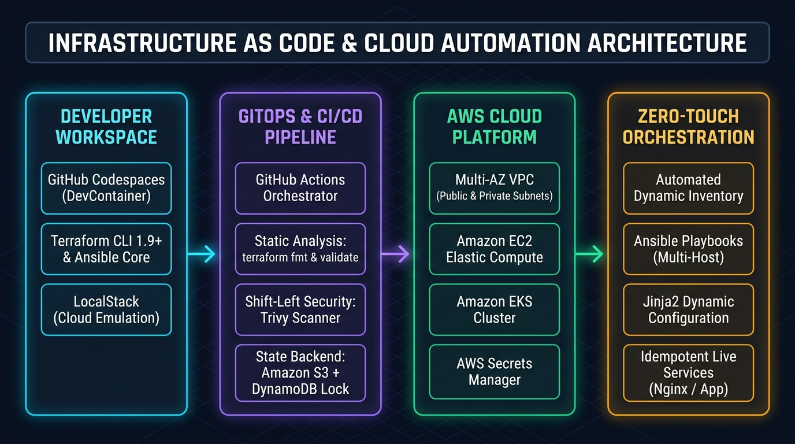

# Enterprise Infrastructure as Code & Cloud Automation Blueprint

[](https://codespaces.new/rafaelmatsuyama/FIAP-DevOps-InfrastructureAsCode)
[](https://www.fiap.com.br/mba/mba-em-devops-engineering/)
[](https://github.com/rafaelmatsuyama/FIAP-DevOps-InfrastructureAsCode/releases)


> **Official reference architecture and interactive hands-on lab suite developed for the [MBA em DevOps Engineering](https://www.fiap.com.br/mba/mba-em-devops-engineering/) at FIAP.**  
> *Covering Declarative Terraform, AWS Cloud Infrastructure, Remote State Management & Locking, Amazon EKS, Shift-Left CI/CD with GitHub Actions & Trivy, Multi-Host Configuration Management with Ansible, and Zero-Touch Hybrid Orchestration.*

---



---

## 🎯 Executive Overview & The Paradigm Shift

Modern enterprise infrastructure operations face the **ClickOps & Configuration Drift Trap**: managing cloud topologies manually through web consoles or ad-hoc shell scripts produces fragile, irreproducible "Snowflake Servers". Over time, unrecorded manual hotfixes and undocumented network adjustments lead to production downtime, compliance violations, and slow release cycles.

This repository establishes an end-to-end, production-grade **Reference Architecture** designed to transition engineering organizations from fragile manual setups to fully automated, auditable, and immutable **Infrastructure as Code (IaC)**. By converging **HashiCorp Terraform**, **Amazon Web Services (AWS)**, **GitHub Actions DevSecOps pipelines**, and **Ansible configuration management**, this blueprint demonstrates how enterprise teams provision and operate mission-critical cloud platforms deterministically.

### The Four Architectural Pillars:

1. **Declarative State-Driven Provisioning:** Enforcing declarative infrastructure definitions where Terraform computes dependency DAGs (Directed Acyclic Graphs), tracks real-world state against code, and executes idempotent convergence.
2. **Modularization & Enterprise Composition:** Eliminating duplicate configurations through reusable, parameter-driven root and child modules, leveraging advanced HCL metaprogramming (`dynamic blocks`, `for_each`, `count`, and `data sources`).
3. **Shift-Left DevSecOps & Continuous Delivery:** Integrating automated quality gates directly into GitHub Actions pull requests, executing linting (`tflint`), formatting, vulnerability scanning (`Trivy`), and policy verification before cloud deployment.
4. **Hybrid Configuration & Zero-Touch Orchestration:** Establishing an automated bridge between declarative infrastructure provisioning (Terraform) and idempotent software configuration (Ansible), achieving end-to-end deployment without human terminal intervention.

---

## 🏗️ End-to-End Architectural Flow

```text
[ Developer Workspace ] ──> [ Git Repository ] ──> [ CI/CD Quality Gate ] ──> [ Cloud Runtime ]
  • Codespaces DevContainer    • Feature Branch      • terraform fmt / validate   • AWS Cloud (VPC, EC2, EKS)
  • LocalStack Emulation       • Pull Request        • Trivy Security Scanner     • S3 Remote State + Lock
  • Terraform + Ansible CLI    • Main Branch         • Automated Deployment       • Ansible Zero-Touch Setup
```

### Lifecycle Architecture Matrix

| Stage | Architectural Phase | Domain Responsibility & Core Actions | Standards & Technology Stack | Production Guarantees & Deliverables |
| :---: | :--- | :--- | :--- | :--- |
| **0** | **Local Simulation & Foundations** (Labs 01, 02) | Introduction to declarative syntax, resource graph, and local provider emulation without cloud costs. | Terraform 1.9+, Local & Docker Providers | Verified local state lifecycle, random UUID generation, and containerized Nginx runtime |
| **1** | **Cloud Compute & State Management** (Labs 03, 04) | Initializing AWS provider, deploying elastic compute, and transitioning local state to remote S3 backend. | AWS EC2, Security Groups, S3 Remote State | Publicly reachable web instances and atomic remote state storage preventing state corruption |
| **2** | **Modularization & Metaprogramming** (Labs 05 to 10) | Refactoring monolithic configs into reusable VPC/EC2 modules, dynamic AMI discovery, and iterative collection expansion. | Reusable HCL Modules, Data Sources, `count`, `for_each`, `dynamic` blocks | DRY modular infrastructure, multi-subnet topologies, and dynamic multi-port firewall rules |
| **3** | **Lifecycle Hooks, Drift & Secrets** (Labs 11 to 14) | Executing operational provisioners, reconciling unmanaged brownfield resources via import, and managing cryptographic secrets. | `local-exec`, `remote-exec`, `terraform import`, AWS Secrets Manager | Automated bootstrap scripts, zero-downtime state import, and runtime credential injection |
| **4** | **Cloud-Native Kubernetes & DevSecOps** (Labs 15, 16) | Provisioning managed Kubernetes control planes with worker nodes, and automating delivery pipelines with shift-left security. | Amazon EKS, AWS IAM Roles, GitHub Actions, Trivy | Production EKS cluster on public subnets and automated CI/CD pipeline blocking vulnerabilities |
| **5** | **Configuration Management & Zero-Touch** (Labs 17, 18) | Multi-host server configuration, dynamic templating via Jinja2, and orchestrating Terraform output directly into Ansible playbooks. | Ansible Core, Jinja2 Templates, Hybrid Orchestration | Idempotent multi-tier software deployment and zero-touch end-to-end cloud provisioning |

---

## 🧪 Modular Hands-on Lab Suite

The repository is structured into 18 self-contained, progressive hands-on laboratories:

| Module | Guides / Roteiros | Enterprise Pain Point | Technical Solution & Modern Stack | Key Deliverable & Artifact |
| :--- | :--- | :--- | :--- | :--- |
| [`lab01-hello_world`](./lab01-hello_world) | [🇧🇷 PT-BR](./lab01-hello_world/Lab%2001%20-%20Roteiro%20Aluno.md) \| [🇺🇸 EN](./lab01-hello_world/Lab%2001%20-%20Student%20Guide.md) | Understanding IaC core concepts without incurring cloud costs or complex credentials | Terraform declarative lifecycle (`init`, `plan`, `apply`, `destroy`) with local providers | Idempotent local text file provisioned with dynamic random UUID |
| [`lab02-docker_basics`](./lab02-docker_basics) | [🇧🇷 PT-BR](./lab02-docker_basics/Lab%2002%20-%20Roteiro%20Aluno.md) \| [🇺🇸 EN](./lab02-docker_basics/Lab%2002%20-%20Student%20Guide.md) | Managing local development runtime dependencies reproducibly | Docker provider integration with Terraform managing image pull and container ports | Functional containerized Nginx web server running via code |
| [`lab03-simple_aws_ec2`](./lab03-simple_aws_ec2) | [🇧🇷 PT-BR](./lab03-simple_aws_ec2/Lab%2003%20-%20Roteiro%20Aluno.md) \| [🇺🇸 EN](./lab03-simple_aws_ec2/Lab%2003%20-%20Student%20Guide.md) | Fricção inicial de onboarding na nuvem e custos desnecessários em testes iniciais | AWS EC2 and Security Group provisioning with LocalStack emulation support | Live EC2 web server accessible on HTTP port 80 |
| [`lab04-terraform_state`](./lab04-terraform_state) | [🇧🇷 PT-BR](./lab04-terraform_state/Lab%2004%20-%20Roteiro%20Aluno.md) \| [🇺🇸 EN](./lab04-terraform_state/Lab%2004%20-%20Student%20Guide.md) | Team collaboration conflicts and accidental state file deletion in local folders | Remote state backend architecture utilizing encrypted AWS S3 storage | Migrated `terraform.tfstate` backed by versioned remote object storage |
| [`lab05-refactoring`](./lab05-refactoring) | [🇧🇷 PT-BR](./lab05-refactoring/Lab%2005%20-%20Roteiro%20Aluno.md) \| [🇺🇸 EN](./lab05-refactoring/Lab%2005%20-%20Student%20Guide.md) | Spaghetti infrastructure codebases where changing one component breaks another | Root-and-child module refactoring isolating network (VPC) from compute (EC2) | Modular, reusable architecture consuming standardized child inputs and outputs |
| [`lab06-datasource`](./lab06-datasource) | [🇧🇷 PT-BR](./lab06-datasource/Lab%2006%20-%20Roteiro%20Aluno.md) \| [🇺🇸 EN](./lab06-datasource/Lab%2006%20-%20Student%20Guide.md) | Hardcoded AMI IDs failing across different AWS regions and deprecation cycles | Dynamic querying using `data "aws_ami"` filters for official Amazon Linux AMIs | Resilient compute declaration adapting automatically to latest patched AMI |
| [`lab07-count`](./lab07-count) | [🇧🇷 PT-BR](./lab07-count/Lab%2007%20-%20Roteiro%20Aluno.md) \| [🇺🇸 EN](./lab07-count/Lab%2007%20-%20Student%20Guide.md) | Code duplication when provisioning multiple identical infrastructure resources | Metaprogramming with `count` and index-based naming conventions | Scaled array of instances managed via a single declarative resource block |
| [`lab08-foreach`](./lab08-foreach) | [🇧🇷 PT-BR](./lab08-foreach/Lab%2008%20-%20Roteiro%20Aluno.md) \| [🇺🇸 EN](./lab08-foreach/Lab%2008%20-%20Student%20Guide.md) | Accidental recreation cascades caused by index shifts in `count` lists | Key-based iteration using `for_each` over mapped resource definitions | Robust resource collection keyed by domain tags without destructive index shifts |
| [`lab09-for`](./lab09-for) | [🇧🇷 PT-BR](./lab09-for/Lab%2009%20-%20Roteiro%20Aluno.md) \| [🇺🇸 EN](./lab09-for/Lab%2009%20-%20Student%20Guide.md) | Inflexible output contracts and inability to transform lists into lookup maps | HCL `for` expressions, list comprehensions, and map transformations | Exported map of server names paired with public IP addresses |
| [`lab10-dynamic_blocks`](./lab10-dynamic_blocks) | [🇧🇷 PT-BR](./lab10-dynamic_blocks/Lab%2010%20-%20Roteiro%20Aluno.md) \| [🇺🇸 EN](./lab10-dynamic_blocks/Lab%2010%20-%20Student%20Guide.md) | Bloated and repetitive security group ingress rules across enterprise ports | `dynamic "ingress"` blocks iterating over structured port and protocol lists | DRY firewall configuration managing multi-port ingress dynamically |
| [`lab11-localexec`](./lab11-localexec) | [🇧🇷 PT-BR](./lab11-localexec/Lab%2011%20-%20Roteiro%20Aluno.md) \| [🇺🇸 EN](./lab11-localexec/Lab%2011%20-%20Student%20Guide.md) | Manual synchronization between provisioned cloud outputs and local deployment tools | Client-side execution via `local-exec` provisioners and template files | Automatically populated local inventory and IP manifest upon resource creation |
| [`lab12-remoteexec`](./lab12-remoteexec) | [🇧🇷 PT-BR](./lab12-remoteexec/Lab%2012%20-%20Roteiro%20Aluno.md) \| [🇺🇸 EN](./lab12-remoteexec/Lab%2012%20-%20Student%20Guide.md) | Post-boot server initialization requiring manual SSH login and command execution | In-line post-provisioning with `remote-exec` over secure SSH connections | Fully configured application web server serving dynamic instance metadata |
| [`lab13-import`](./lab13-import) | [🇧🇷 PT-BR](./lab13-import/Lab%2013%20-%20Roteiro%20Aluno.md) \| [🇺🇸 EN](./lab13-import/Lab%2013%20-%20Student%20Guide.md) | Brownfield cloud resources created manually without IaC management | Reconciling existing cloud assets into Terraform state via `terraform import` | Brownfield EC2 adopted into code with 0 drift on subsequent plans |
| [`lab14-secrets`](./lab14-secrets) | [🇧🇷 PT-BR](./lab14-secrets/Lab%2014%20-%20Roteiro%20Aluno.md) \| [🇺🇸 EN](./lab14-secrets/Lab%2014%20-%20Student%20Guide.md) | Hardcoded API tokens and database credentials committed to public Git repos | Secrets management integration with AWS Secrets Manager and dynamic retrieval | Secure credential consumption without plain-text exposure in version control |
| [`lab15-eks`](./lab15-eks) | [🇧🇷 PT-BR](./lab15-eks/Lab%2015%20-%20Roteiro%20Aluno.md) \| [🇺🇸 EN](./lab15-eks/Lab%2015%20-%20Student%20Guide.md) | High complexity of provisioning production Kubernetes control planes and nodes | Amazon EKS cluster architecture with managed Node Groups on optimized subnets | Enterprise-ready Kubernetes cluster ready for containerized workloads |
| [`lab16-cicd`](./lab16-cicd) | [🇧🇷 PT-BR](./lab16-cicd/Lab%2016%20-%20Roteiro%20Aluno.md) \| [🇺🇸 EN](./lab16-cicd/Lab%2016%20-%20Student%20Guide.md) | High-risk manual deployments from developer laptops without security audits | GitHub Actions pipeline integrating `fmt`, `validate`, Trivy, and automated deploy | Automated Quality Gate enforcing static analysis and zero-vulnerability standards |
| [`lab17-ansible`](./lab17-ansible) | [🇧🇷 PT-BR](./lab17-ansible/Lab%2017%20-%20Roteiro%20Aluno.md) \| [🇺🇸 EN](./lab17-ansible/Lab%2017%20-%20Student%20Guide.md) | Imperative bash scripts failing silently and lacking configuration idempotency | Multi-host configuration management with Ansible playbooks and Jinja2 templates | Idempotent multi-tier configuration deploying web services across hosts |
| [`lab18-zero-touch`](./lab18-zero-touch) | [🇧🇷 PT-BR](./lab18-zero-touch/Lab%2018%20-%20Roteiro%20Aluno.md) \| [🇺🇸 EN](./lab18-zero-touch/Lab%2018%20-%20Student%20Guide.md) | Disconnected silos between cloud infrastructure provisioning and app configuration | Zero-touch orchestration binding Terraform outputs directly into Ansible automation | Unified pipeline: single execution provisions cloud hardware and configures services |

---

## 🚀 Quickstart Guides (Zero-Friction Bootstrap)

### Option A: GitHub Codespaces (Recommended)

Click the button below to launch a fully configured Linux cloud container with Terraform 1.9+, AWS CLI v2, Docker, Ansible, and TFLint pre-installed:

[](https://codespaces.new/rafaelmatsuyama/FIAP-DevOps-InfrastructureAsCode)

*Once Codespaces is ready:*
```bash
# 1. Navigate to the desired laboratory (e.g. Lab 01)
cd lab01-hello_world

# 2. Follow the guided instructions in your preferred language
cat "Lab 01 - Student Guide.md"      # 🇺🇸 English Guide
# or: cat "Lab 01 - Roteiro Aluno.md"  # 🇧🇷 Portuguese Guide

# 3. Initialize and apply Terraform
terraform init
terraform apply
```

### Option B: Local Machine Execution

**Prerequisites:** Terraform 1.9+, AWS CLI v2, Docker & Docker Compose, Ansible Core 2.16+, Git.

```bash
# Clone the repository
git clone https://github.com/rafaelmatsuyama/FIAP-DevOps-InfrastructureAsCode.git
cd FIAP-DevOps-InfrastructureAsCode

# Configure AWS Credentials
aws configure
```

### Environment Compatibility Matrix

| Feature / Scenario | AWS Academy Learner Lab | LocalStack (Emulation) | AWS Commercial Account |
| :--- | :---: | :---: | :---: |
| **Basic Compute & VPC (Labs 01-14)** | Full Support (`us-east-1`) | Full Support (Docker) | Full Support (Any Region) |
| **Amazon EKS (Lab 15)** | Supported on Public Subnets | Requires LocalStack Pro | Full Support (Public & Private) |
| **Secrets Manager (Lab 14)** | Full Support | Requires LocalStack Pro | Full Support |
| **CI/CD via GitHub Actions (Lab 16)** | Supported via Session Tokens | Local Runner | Full Support (OIDC / IAM Roles) |
| **Ansible Zero-Touch (Labs 17-18)** | Full Support (SSH on EC2) | Supported via Containers | Full Support |

---

## ⚙️ Key Architectural Patterns & Production Hardening

This reference architecture incorporates essential engineering practices learned from enterprise cloud operations:

* **Remote State Integrity & Concurrency Control:**  
  Storing state locally creates an immediate risk of concurrent overwrites and credential leaks. Production deployments configure an encrypted AWS S3 bucket with versioning enabled alongside a DynamoDB table for distributed state locking (`dynamodb_table`), preventing corrupted state files during simultaneous pipeline executions.
* **Deterministic AMI Resolution vs. Version Pinning:**  
  While `data "aws_ami"` filters automate the discovery of the latest official Amazon Linux release, enterprise production workloads pin specific AMI release IDs or consume validated Golden Images from private EC2 Image Builder pipelines to prevent untested upstream kernel changes from destabilizing production workloads.
* **Kubernetes Control Plane vs. Node Group Networking:**  
  In constrained cloud environments (such as AWS Academy), allocating EKS worker node groups in private subnets without an active NAT Gateway causes node registration timeouts. Production clusters route worker nodes through properly configured NAT Gateways or place public endpoints with strict security group ingress rules.
* **Zero-Touch Provisioning and Idempotent Configuration:**  
  Combining Terraform and Ansible creates a clear separation of concerns: Terraform acts as the declarative hardware provisioner, while Ansible acts as the idempotent software configurer. Passing dynamically computed IP outputs from Terraform directly into an Ansible template inventory eliminates fragile hardcoded IP addresses.
* **Shift-Left Security & Vulnerability Scanning:**  
  Every infrastructure commit must pass automated verification in CI/CD before hitting production. Executing `tflint` detects invalid AWS resource configurations statically, while `Trivy` audits HCL manifests for misconfigurations (such as open `0.0.0.0/0` security groups) before executing `terraform apply`.

---

## 🎓 Academic Validation & Field Hardening

This framework and comprehensive laboratory suite were architected, refined, and battle-tested by **Rafael Matsuyama** as part of the **Infrastructure as Code (IaC)** curriculum for the **Executive MBA in DevOps Engineering at FIAP** (São Paulo, Brazil).

Senior DevOps engineers, Site Reliability Engineers (SREs), cloud architects, and tech leaders across enterprise cohorts have executed, validated, and stress-tested these scenarios, providing continuous feedback to ensure that every laboratory reflects real-world corporate cloud engineering workloads.

---

## 🏷️ Release Cadence & Versioning Policy

This repository follows a strict **Calendar Versioning with Cycle and Patch semantics (CalVer)** (`vYYYY.CYCLE.PATCH`) to balance enterprise technical stability with annual executive curriculum delivery:

```text
  v2026 . 1 . 0
    │     │   │
    │     │   └── PATCH: Hotfixes, dependency bumps & documentation errata
    │     └────── CYCLE: Major content iterations or new lab modules
    └──────────── YEAR:  Annual technology stack baseline & MBA curriculum edition
```

* **Deterministic Reproducibility:** Each tagged release provides an immutable snapshot where all manifests, playbooks, guides, and CI/CD pipelines are verified to run deterministically.
* **Academic Cohort Pinning:** Students or corporate teams standardizing on past editions can pin their environment directly to the official release tag:
  ```bash
  git checkout tags/v2026.1.0
  ```
* All milestone releases and automated release notes are available on the official [GitHub Releases](https://github.com/rafaelmatsuyama/FIAP-DevOps-InfrastructureAsCode/releases) page.

---

## 👨‍💻 Author & Leadership

**Rafael Matsuyama**  
*Solutions Architect & DevOps Engineering Specialist*  
Engineering graduate from **Escola Politécnica da Universidade de São Paulo (Poli-USP)** with over two decades of experience across Cloud Architecture, Distributed Systems, Mission-Critical Platforms, and Academic Leadership.

* 🌐 **LinkedIn:** [linkedin.com/in/rafaelmatsuyama](https://www.linkedin.com/in/rafaelmatsuyama)
* 🐙 **GitHub:** [github.com/rafaelmatsuyama](https://github.com/rafaelmatsuyama)

---

## 📜 Dual Licensing Model

This repository employs a **dual-licensing structure** to encourage enterprise adoption of the codebase while protecting educational materials from unauthorized commercial resale:

* 💻 **Code, Manifests & Playbooks (`*.tf`, `*.hcl`, `*.yml`, `*.py`, `*.sh`):** Licensed under the **[Apache 2.0 License](LICENSE)**. Permissive and free to be used, adapted, and integrated into enterprise production environments.
* 📚 **Educational Content & Manuals (`*.md` lab guides, guides, diagrams):** Licensed under **[Creative Commons Attribution-NonCommercial-ShareAlike 4.0 International (CC BY-NC-SA 4.0)](https://creativecommons.org/licenses/by-nc-sa/4.0/)**. Free for personal learning, study, and educational reference; commercial reproduction, selling, or course packaging by third parties is strictly prohibited.
